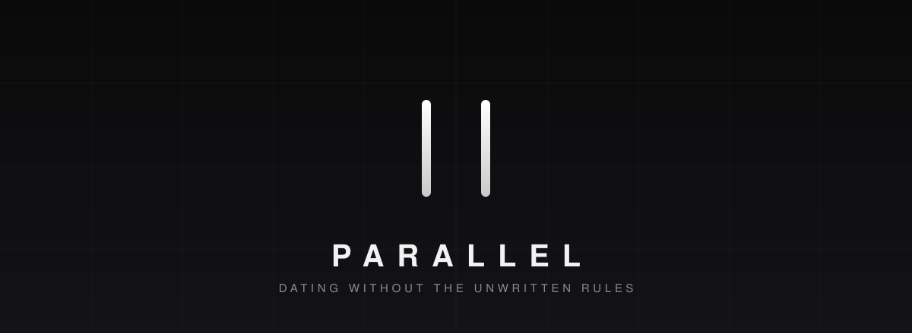
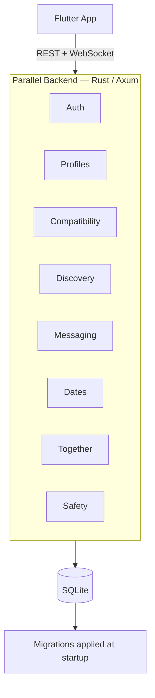

<p align="center">
  
</p>

<h1 align="center">Parallel</h1>

<p align="center">
  <em>Dating without the unwritten rules.</em><br/>
  A neurodivergent-first dating and relationship app — engineered for people the dating industry was never designed for.
</p>

<p align="center">
  
  
  
  
</p>

---

## What is Parallel?

Most dating apps are engineered to keep you swiping. **Parallel is engineered to help you stop.**

It's a dating and relationship platform designed first for autistic and neurodivergent adults — built on the belief that the problem isn't people, it's the *unwritten rules*. Ambiguous signals. Social guesswork. Sensory overload. Dates with no exit. Streaks, fake urgency, and gamified scarcity that treat being single as a bug to monetize.

Parallel removes those rules and replaces them with structure, honesty, and doors. It doesn't infantilize or turn neurodivergence into a gimmick — it treats clarity as the product.

> ### A communication protocol for relationships.
> The app stays useful long after two people start dating — from first introduction to a shared life.

## The lifecycle it serves

| Phase | What Parallel does |
| ----- | ------------------ |
| **Discover** | 3–7 meaningful introductions a day — not an infinite swipe casino. Every card explains *why* you're seeing this person. |
| **Understand** | A compatibility engine that explains itself: *what's aligned, what to talk about, what's probably irrelevant.* No single magic percentage. |
| **Connect** | **Introduce Me** instead of Like. Intent is signalled deliberately and revealed honestly — mutual signals tell both of you. |
| **Communicate** | Conversation contracts set the norms up front. `NO RESPONSE NEEDED` flags. A social-capacity meter so quiet isn't read as rejection. |
| **Meet** | Date Builder finds sensory overlap (noise, crowd, lighting, walking, cost). Every plan ships with Plan B and C. Leaving early is okay. |
| **Sync** | **Together Mode** — temporary, explicit, door-bearing. Silent signals, private questions, haptic tap-language, a non-stop **END DATE** button. |
| **Reflect** | A tiny post-date debrief. Relationship Mode that becomes *more* useful, not less: a shared manual, check-ins, repair support. |
| **Build** | A communication protocol for relationships — the long-term product vision. |

## Design principles the API enforces

- **Low-stakes discovery.** Introduction reasons show *why* — shared interests and readable explain lines, not just a face.
- **No silent guesswork.** Compatibility output is always a human-readable *"Here's what's aligned, here's what to talk about"* (`GET /compat/explain/{id}`).
- **Explicit over implicit.** Intent is signalled deliberately (`romantic · more_time · friendship · unsure · meet · not_compatible`) and revealed honestly when mutual.
- **Capacity-aware messaging.** Each person publishes a social-capacity status (battery 0–4 + temperature); conversation contracts let either side set clear norms.
- **Together sessions are meetings with a door.** A pairing code, a permission scope the app honours, a non-stop exit button, optional signals (`quiet · overwhelmed · need_exit · ...`) and nothing saved when `no_data_saved` is set.
- **Exit ramps everywhere.** Plans decline gracefully, blocks remove past introductions permanently, reports remove you from someone's discovery pool.

## Architecture



A **modular monolith** — deliberately. No premature microservices. One embedded database, no server to run, auth handled with Argon2-hashed passwords and session tokens.

## Repository layout

| Path | What it is |
| ---- | ---------- |
| `backend/` | Rust backend — Axum + Tokio + SQLx + SQLite. The whole product API. |
| `apps/mobile/` | Flutter mobile app (scaffolded; models mirror the shared schemas). |
| `packages/api_contract/` | Human-readable API contract — routes, bodies, status codes, semantics. |
| `packages/shared_schemas/` | Machine-readable `schemas.json` for the app's model layer. |
| `PARALLEL_MASTER_DESIGN_RECORD.md` | The full product vision — 80+ sections of design, safety and accessibility. |
| `assets/` | Brand artwork (this README's hero). |

## Quick start

**Prerequisites:** a recent stable Rust toolchain. That's it — SQLite is embedded, no database server needed.

```bash
cd backend
cargo run                          # listens on 0.0.0.0:8080, uses sqlite://parallel.db
PORT=9000 cargo run                # override the port
DATABASE_URL=sqlite://x.db cargo run   # override the db file
```

The schema is created automatically from `backend/migrations/` at startup.

### Try it in 10 seconds

Debug builds expose `POST /dev/seed`, which creates three demo users — Alex, Maya and Cedric — and returns live tokens:

```bash
curl -s -X POST http://localhost:8080/dev/seed
```

That one call exercises auth, then you can discover, compare compatibility, message, plan a date and start a Together session end to end.

### The API surface at a glance

| Area | What's live |
| ---- | ----------- |
| `POST /auth/register · /login · /logout` | Session tokens, Argon2 password hashing |
| `GET /discover/today` | Capped at 5/day, filtered by city + `discovery_enabled`, no repeat introductions |
| `POST /discover/introduce` | Optional reason; returns a match the moment both want an introduction |
| `GET /compat/catalog · /compat/explain/{id}` | Multidimensional, self-explaining compatibility |
| `GET /messaging/conversations` · `POST /messages` | Messaging with `no_response_needed` support |
| `PUT /messaging/status/me` | Social-capacity battery + temperature |
| `POST /dates/plans` | Plan A / B / C dates with accept–decline–done lifecycle |
| `POST /together/sessions` | Pairing-code live sessions with silent signals |
| `POST /safety/blocks` | Blocks unmatch permanently and clear future introductions |
| `WS /ws/chat · /ws/session` | Real-time chat and Together-session events |

The full route table, bodies and error semantics live in [`packages/api_contract/README.md`](packages/api_contract/README.md).

## Tests

```bash
cd backend
cargo test
```

- **7** compatibility-engine unit tests (`src/unit.rs`)
- **1** end-to-end vertical-slice test (`tests/e2e.rs`) — exercises auth, profiles, compatibility, discovery, mutual introductions, messaging, intent signals, social status, date plans, together sessions, safety blocks/reports, seeding and public profiles against an in-memory DB.

## Mobile app

```bash
cd apps/mobile
flutter run -d windows    # or -d chrome, or an attached device
```

The app expects the backend on `localhost:8080` (set `API_BASE` in its API client). Model classes mirror `packages/shared_schemas/schemas.json`.

## Status

- [x] Backend — full product lifecycle implemented and covered by tests
- [x] API contract — produced from the live implementation, verified end to end
- [x] Mobile app — Flutter client with auth, discovery, compatibility, messaging, dates, Together and safety screens wired to the live API (deeper flows still in progress)
- [ ] Together Mode device pairing (QR / NFC / Bluetooth)
- [ ] Sensory venue database & Parallel-friendly venues
- [ ] Relationship Mode (shared manual, check-ins, repair)

## Design record

The entire product philosophy — brand, visual system, safety architecture, monetization, technology decisions — lives in [`PARALLEL_MASTER_DESIGN_RECORD.md`](PARALLEL_MASTER_DESIGN_RECORD.md).

> **Ⅱ** — two parallel lines: two individuals who remain distinct.

No swipe-casino. No fake urgency. No streaks. Product success doesn't depend on keeping anyone single.